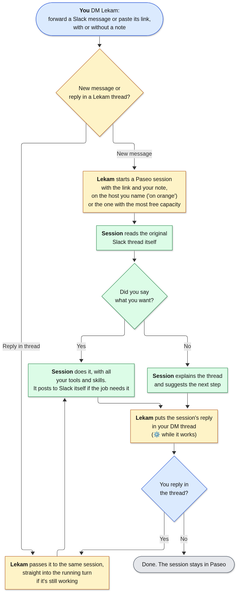

# Lekam

**Chat with a [Paseo](https://paseo.sh) agent session from a Slack DM.**

*Lekam* (ලේකම්, Sinhala): secretary.

1. Forward a Slack message to Lekam (or paste its link), with a note saying what you want.
2. Lekam starts a Paseo session with the message's link and your note. The session reads the thread itself with its own Slack tools and does what you asked. With no note, it works out what the thread needs and suggests the next step.
3. The DM thread under your forward is your chat with that session: your replies go to it, its replies come back there (⚙️ while it works). A reply while it's still working goes straight into the running turn (steering, not interrupting), and its answer covers both.

**Which machine:** say "on orange" (or any host name) in your note to choose. Otherwise the session goes to the host with the most free capacity right now. Replies always go to the host the thread's session is on.

That's all. Lekam posts nowhere except your DM threads with it, and only for its owner. Anything that has to go out to Slack (a reply in the original thread, a message to someone), the session posts itself with its own Slack tools.



Blue is you, yellow is Lekam, green is the Paseo session. Source: [`docs/flow.mmd`](docs/flow.mmd) (Mermaid).

## Run

Needs Node 22.13+, a Paseo daemon, and a Slack app made from `config/slack-manifest.yml` (Socket Mode, bot scopes `im:history`, `chat:write`, `reactions:write`, `users:read`, event `message.im`).

| Env | Default | |
|---|---|---|
| `LEKAM_SLACK_BOT_TOKEN` | | `xoxb-…` |
| `LEKAM_SLACK_APP_TOKEN` | | `xapp-…` (Socket Mode) |
| `LEKAM_OWNER` | | your Slack user id; DMs from anyone else are ignored |
| `LEKAM_HOSTS` | `<hostname>=ws://127.0.0.1:6767/ws` | Paseo daemons as `name=target`, comma-separated; `ssh://user@host` reaches another machine's daemon over SSH. The first is the fallback |
| `LEKAM_CAPACITY_SCRIPT` | `~/.agents/skills/host-dispatch/scripts/capacity.mjs` | prints `--json` with the `best` host; missing or failing = first host |
| `LEKAM_PROVIDER` | `pi/litellm/claude-opus-5-5` | `provider/model` for new sessions |
| `LEKAM_THINKING` | `xhigh` | reasoning level for new sessions (the provider's thinking option id) |
| `LEKAM_CWD` | `~/work` | working directory for new sessions |
| `LEKAM_TURN_TIMEOUT_MIN` | `120` | after this the session keeps going in Paseo; Lekam stops waiting |

```bash
npm install
npm test
LEKAM_OWNER=U… npm start          # or install config/lekam.service as a systemd user unit
```

Sessions are labelled `lekam=dm` and `lekam_thread=<DM thread ts>`, so a restart finds them again. A reply in progress during a restart is not relayed; open the session in Paseo.

The approval-gated "front door" that came before is tagged `v1-final`.

## License

Apache-2.0
